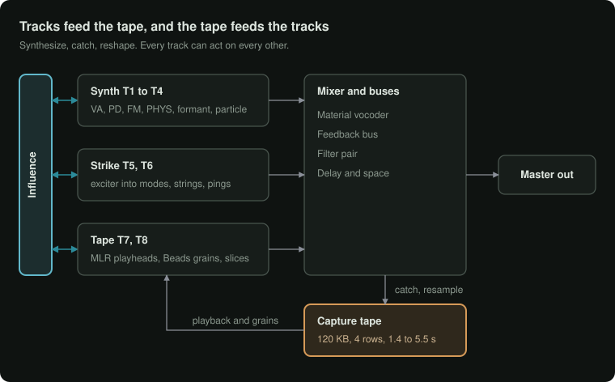

# FM-1 firmware (working name)

A custom firmware for the M-VAVE FM-1 that turns it into a pocket groovebox for sound design. It has 8 tracks that synthesize, catch what they play onto a shared tape, and cut it up and rebuild it, and the tracks can play, excite and reshape each other.

<p align="center">
  
</p>

**Status: early.** The design is written and the first engine, a fixed-point port of Mutable Instruments Beads, runs and is tested against the original. Nothing runs on the FM-1 yet.

## What it is

- **Synth tracks** (T1 to T4): virtual analog with supersaw, phase distortion, FM, physical modelling and formant engines.
- **Strike tracks** (T5, T6): percussion synthesis. An exciter (click, noise, metallic noise, FM burst or another track's audio) strikes ping filters, modal bodies, a struck disc or coupled strings, followed by ring mod and fold.
- **Tape tracks** (T7, T8): no oscillator. They play a shared 192 KB capture tape with MLR-style playheads, through the Beads grain engine, or as slices played from the sequencer.
- **Influence:** an 8 × 8 grid where any track can modulate, trigger, excite, jump the tape of, or clock any other track.
- **Envelope-first articulation:** onset, continuant and termination states drive level, filter and more from one gesture, plus a library of envelope shapes steps can recall.
- **Sequencer:** parameter locks, microtiming, ratchets, a graph mode where cords set the playhead's path, René-style clocking, and a two-oscillator master clock.
- **Song building:** patterns, scenes, clip launching and an arrangement.

The full design is in the design doc (link to come).

## What's here so far

| Path | What |
| --- | --- |
| `core/beads/` | Beads' grain and delay engine, rewritten in integer C for the FM-1 (MIT, see `LICENSE-beads`) |
| `tests/beads/` | Renders 13 test scenarios through the original float code and the port, and compares them |
| `tools/gen_bd_tables.py` | Generates the port's lookup tables |
| `docs/` | The signal-flow diagram |

### The Beads port

- **Coverage:** all of Beads' grain mode (32 grains, Time, Size, Shape, Pitch, Density with its regular, tapped, random and clocked modes, Random, freeze, feedback) and its delay mode (synced and free multitap delay, frozen slices). The tape can be 8-bit µ-law, 12-bit or 16-bit, mono or stereo.
- **Left out:** the reverb, wow and flutter, and the wavetable synth mode, which this firmware doesn't use.
- **Maths:** integers only. No floating point and no C library, so it builds for 32-bit embedded targets as it is.
- **Memory:** about 21 KB of code and 6 KB of tables in flash, 3 KB of state, plus the tape buffer.
- **Accuracy:** checked against the original, unchanged Beads code on every scenario. Level, loudness envelope and brightness all match; see `tests/beads/compare.py` for the thresholds.
- **Cost:** about 600 to 1,600 instructions per sample on typical settings (measured on x86). A dense cloud of 32 overlapping grains costs about 6,000, which is the next thing to optimize.

Run the comparison:

```
cd tests/beads
make fetch    # clones the original Beads and stmlib for the reference
make test
```

The renders land in `tests/beads/out/` as WAV files: `<scenario>_ref.wav` is the original and `<scenario>_port.wav` the port.

## Hardware

The FM-1 has a JieLi AC791N with two cores, 96 KB of main RAM, a 336 KB memory pool and 29 KB of low SRAM, 4 to 8 MB of flash, a 240 × 240 screen, 27 keys, 14 buttons and 7 endless encoders. The firmware will build on the hardware layer, update loader, web installer and browser emulator of the [Felucca](https://github.com/juanjiant-bit/JIANT) family, so it can be played in a browser before it is flashed.

## Licence

GPL-3.0 (see `LICENSE`), as required by the Felucca-family code it will build on. The Beads port in `core/beads/` keeps Mutable Instruments' MIT licence (see `core/beads/LICENSE-beads`).

## Thanks

Mutable Instruments (Émilie Gillet) for Beads; the authors of Felucca, JIANT, SLOOP and sloopDX for opening up the FM-1.
